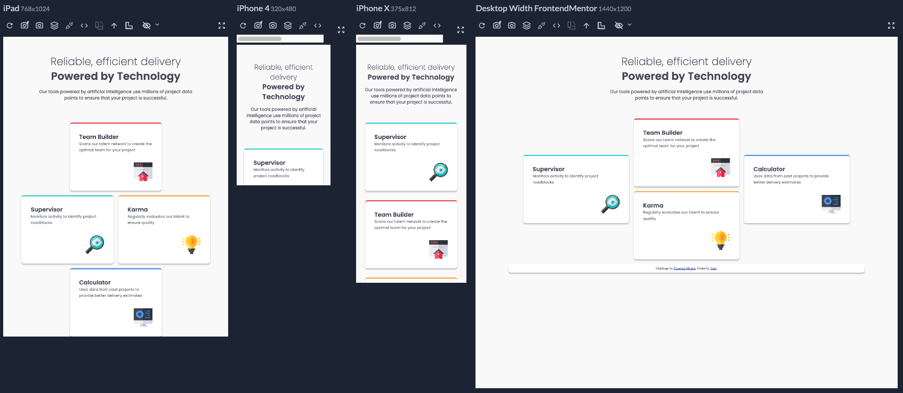

# Frontend Mentor - Four-card feature section solution

This is a solution to the [Four-card feature section challenge on Frontend Mentor](https://www.frontendmentor.io/challenges/four-card-feature-section-weK1eFYK). Frontend Mentor challenges help you improve your coding skills by building realistic projects. 

## Table of contents

- [Overview](#overview)
  - [The challenge](#the-challenge)
  - [Screenshot](#screenshot)
  - [Links](#links)
- [My process](#my-process)
  - [Built with](#built-with)
  - [What I learned](#what-i-learned)
  - [Useful resources](#useful-resources)
  - [AI Collaboration](#ai-collaboration)
- [Author](#author)

## Overview

### The challenge

Users should be able to:

- View the optimal layout for the site depending on their device's screen size

### Screenshot

### Links

- [GitHub repository](https://github.com/RoomForEpsilon/four-card-feature-section)
- [Live site](https://roomforepsilon.github.io/four-card-feature-section/)

## My process

### Built with

- Semantic HTML5 markup
- CSS custom properties
- CSS Grid
- Mobile-first workflow
- Sass 

### What I learned

This was my first project using CSS Grid.  It took a little while to work through all the kinks of using a new tool, but the page turned out all right.  It's going to be another useful tool in the toolbox.

The major thing that I need to improve on is my overreliance on AI.  Even though I only asked it for help when I became stuck, I feel as though I could have come up with the solutions to my problems if I had spent more time thinking about them.  Using AI at this level is a trade-off between speed and developing problem-solving ability.  I really want to get to doing things with JavaScript and working with APIs, but I think I'm slightly hindering my ability to solve CSS problems.  Additionally, I started having AI do tasks like put a div around some elements, but that ate into my tokens quickly.  If the token cost doesn't improve, the cost for companies to use AI is going to be astronomically high.  Perhaps that's just OpenAI trying to get me to pay more for a new plan.  Or perhaps that's a sign of things to come.  

### Useful resources

- [Codecademy](https://www.codecademy) - I used Codecademy's Learn CSS: Flexbox and Grid module to prepare for using CSS Grid.  I like Codecademy. I feel like it's equivalent to an interactive textbook, which is really useful, but it costs too much.

### AI Collaboration

I wanted to try incorporating AI more in this project.  I started by telling it which tags to put around which text in index.html, but I was quickly notified that I went over my 5-hour time limit, and I used 1/3 of my weekly token limit.  That was all for about 10 lines of wrapping text in different HTML tags.  It saved time typing, but it's not worth the token cost.  I like having AI as a debugging tool.  There are so many times when I do something like forget to put parentheses at the end of a function, and AI is great for figuring that out, instead of me having to debug for a couple of days before I notice something like that.  I'll stick with AI debugging for my AI use for now.

## Author

- Frontend Mentor - [@RoomForEpsilon](https://www.frontendmentor.io/profile/RoomForEpsilon)

